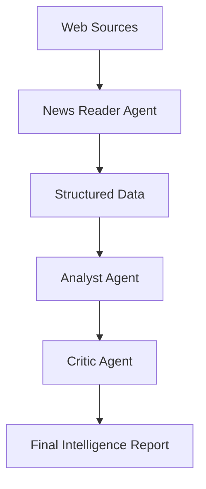

# System Architecture

The CLO Intelligence Pipeline is designed as a multi-agent system where each agent handles a specific part of the intelligence lifecycle.

## Agent Lifecycle

1. **Information Retrieval (News Reader)**: Scrapes web data and parses it into structured entities.
2. **Analysis (Analyst)**: Evaluates the structured data against market trends and historical data.
3. **Stress Testing (Critic)**: Challenges the analysis, looking for hidden risks or groupthink.

## Data Flow

## AI Agent Integration

The project uses a dual-layer approach for AI agents:
- **Logical Layer (`src/agents/`)**: Python implementation of the tools and logic the agents use.
- **Instructional Layer (`.agent/skills/`)**: High-level instructions that define the agent's persona and mission.
